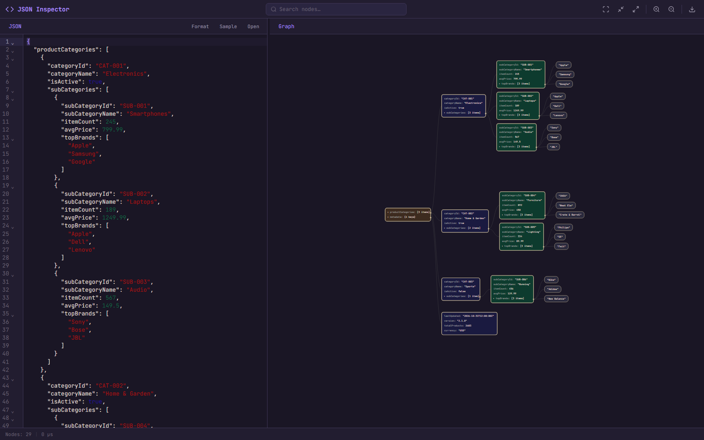

# JSON Inspector

A browser-based tool for editing JSON and exploring its structure as an
interactive graph.

## Example

The editor and interactive graph are shown side by side:



## Requirements

- Node.js 20.19+ or 22.12+
- npm

## Run locally

```sh
npm ci
npm run dev
```

Open the local URL printed by Vite (by default, `http://localhost:3000`).

## Features

- Edit JSON with syntax highlighting, formatting, and inline parse diagnostics.
- JSON parsing, graph projection, and formatting run in a Web Worker to keep
  expensive processing off the UI thread.
- Explore nested objects and arrays in a graph; expand or collapse branches.
- New documents show the root and its immediate nested cards first; deeper
  graph nodes are created only when their branches are expanded.
- Expand and collapse graph branches with Enter or Space; nesting beyond 100
  graph levels is reported as an error.
- Search visible graph rows, pan and zoom, and fit the graph to the viewport.
- Right-click a graph item to copy its JSON value, path, or key.
- Select a graph block, then press `Ctrl/Cmd+C` to copy its JSON or
  `Ctrl/Cmd+Alt+C` to copy its path.
- Open `.json` and `.geojson` files.
- Export the graph as an SVG image.

The graph is cleared when the editor contains invalid JSON, so it never appears
to represent data that failed to parse.

## Source structure

- `src/app/` coordinates document, search, and graph state.
- `src/json/` contains framework-independent JSON value types and parsing.
- `src/workers/` runs JSON parsing, graph projection, and formatting off the
  main thread; stale results are discarded when newer editor input arrives.
- `src/graph/projection.ts` adapts JSON values into graph-specific interactive
  state; layout, search, SVG rendering, and interactions stay in `src/graph/`.
- `src/editor/` adapts CodeMirror to the application.
- `src/files/` contains SVG export operations.
- `src/ui/` contains reusable interface utilities such as the status bar and pane resizer.
- `src/main.ts` initializes the app and connects UI events to the controller.

## Checks

```sh
npm test
npm run build
```
