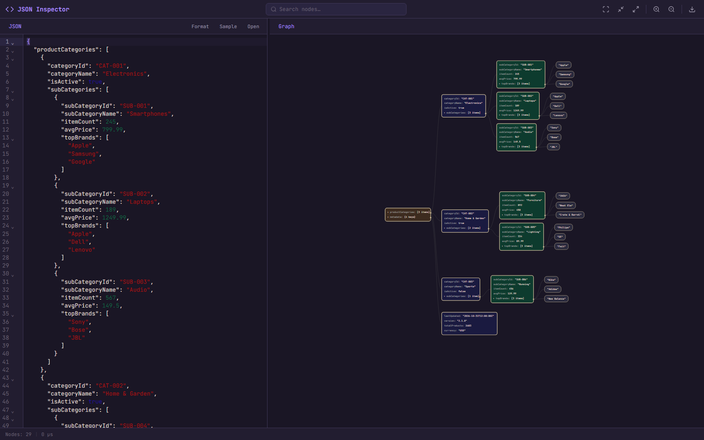

# JSON Inspector

A browser-based tool for editing JSON and exploring its structure as an
interactive graph.

## Example

The editor and interactive graph are shown side by side:



## Requirements

- Node.js 20.19+ or 22.12+
- npm

## Run locally

```sh
npm ci
npm run dev
```

Open the local URL printed by Vite (by default, `http://localhost:3000`).

## Tech Stack

- **Frontend & Tooling**: TypeScript, Vite 8.
- **Editor**: CodeMirror 6 (syntax highlighting, folding, JSON linting).
- **WebAssembly**: AssemblyScript compiles high-performance spatial collision & viewport queries into sub-kilobyte WebAssembly (`public/spatial.wasm`) with zero native C++/Rust toolchain dependencies.
- **Web Workers**: Offloads JSON parsing, tree projection, and formatting off the UI thread to keep interactions smooth.
- **Modern Web Standards**:
  - Declarative `<dialog closedby="any">` and `commandfor="show-modal"` for accessible modals.
  - Native `popover="auto"` context menu with `@starting-style` and `:popover-open` transitions.
  - Standard CSS `scrollbar-width` and `scrollbar-color`.
  - IME-safe keyboard handling (`isComposing` & `VK_PROCESSKEY`).
- **Chrome Extension (Manifest V3)**: Can be loaded as an unpacked extension into Google Chrome as a **Side Panel** (`chrome.sidePanel`) and **DevTools Panel** (`chrome.devtools.panels`).

## Features

- Edit JSON with syntax highlighting, formatting, and inline parse diagnostics.
- JSON parsing, graph projection, and formatting run in a Web Worker to keep
  expensive processing off the UI thread.
- Explore nested objects and arrays in a graph; expand or collapse branches.
- New documents show the root and its immediate nested cards first; deeper
  graph nodes are created only when their branches are expanded.
- Arrays with more than 100 items start collapsed to keep initial graph
  construction and layout responsive. This applies to root arrays and arrays
  nested inside objects. Use **Expand all nodes** to open the complete graph,
  including large arrays.
- Only nodes in the graph viewport and a small overscan region are inserted into
  the SVG; panning, zooming, and resizing update the rendered set.
- The expanded graph is spatially indexed in **WebAssembly**, so viewport redraws
  query visible nodes and edges in microseconds without JavaScript GC pauses.
- Expand and collapse graph branches with Enter or Space; nesting beyond 100
  graph levels is reported as an error.
- Search visible graph rows, pan and zoom, and fit the graph to the viewport.
- Right-click a graph item to open a native popover menu to copy its JSON value, path, or key.
- Select a graph block, then press `Ctrl+C` (`⌘+C` on macOS) to copy its JSON or
  `Ctrl+Alt+C` (`⌘+Option+C` on macOS) to copy its path.
- Open `.json` and `.geojson` files.
- Export the graph as an SVG image.
- Built-in Keyboard Shortcuts & Help dialog (press `?` or click the toolbar icon).
- Ready to load as a Chrome Extension in Chrome Side Panel or Chrome DevTools.

The graph is cleared when the editor contains invalid JSON, so it never appears
to represent data that failed to parse.

## Source structure

- `assembly/` contains AssemblyScript source files compiled to WebAssembly (`public/spatial.wasm`).
- `src/app/` coordinates document, search, and graph state.
- `src/json/` contains framework-independent JSON value types and parsing.
- `src/workers/` runs JSON parsing, graph projection, and formatting off the
  main thread; stale results are discarded when newer editor input arrives.
- `src/graph/projection.ts` adapts JSON values into graph-specific interactive
  state; layout, search, SVG rendering, and interactions stay in `src/graph/`.
- `src/editor/` adapts CodeMirror to the application.
- `src/files/` contains SVG export operations.
- `src/ui/` contains reusable interface utilities such as the status bar and pane resizer.
- `src/main.ts` initializes the app and connects UI events to the controller.

## Checks

```sh
npm test
npm run build
npm run benchmark
npx playwright install chromium
npm run test:e2e
```

The benchmark suite measures JSON parsing, graph construction, row flattening,
layout, and SVG generation separately. Its initial local measurements and
environment caveats are recorded in [benchmarks/BASELINE.md](./benchmarks/BASELINE.md).
Playwright's Chromium install is only needed once per machine.
